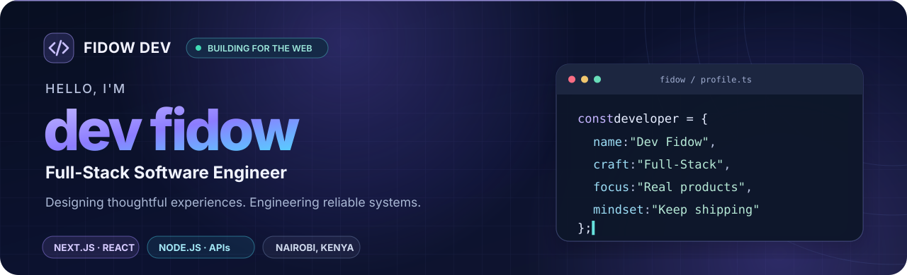
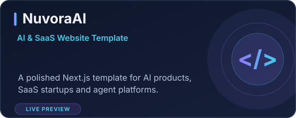
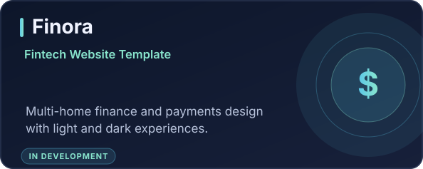
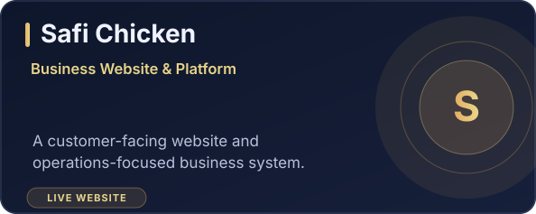
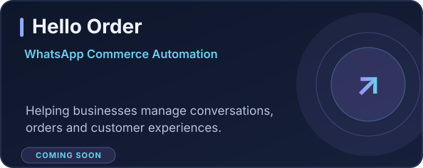

<!--
  DEV FIDOW — GITHUB PROFILE README
  IMPORTANT: Replace every YOUR_GITHUB_USERNAME below with your exact GitHub username.
  Your GitHub profile README repository must be named exactly the same as your username.
  This repository includes the SVG assets used below. Keep the assets/ folder.
-->

<div align="center">
  

  <br />

  <a href="https://fidow.dev/"></a>
  <a href="mailto:hello@fidow.dev"></a>
  <a href="https://www.linkedin.com/in/eng-fidow/"></a>

  <br /><br />

  **Software Engineer · Full-Stack Developer · Product Builder**

  *I turn ideas into thoughtful digital experiences and practical systems that solve real problems.*

  📍 Nairobi, Kenya &nbsp; • &nbsp; 🌍 Building for local and global audiences &nbsp; • &nbsp; 🚀 Always learning, always shipping
</div>

---

### `01 / ABOUT ME`

I'm **Dev Fidow**, a software engineer who enjoys taking products from the first idea to a real, usable experience. I work across **frontend, backend, mobile and business automation** — with a particular interest in premium interface design, developer-friendly architecture, and tools that help companies work smarter.

- 🎨 **Frontend:** modern, fast, responsive websites and polished UI systems.
- 🧠 **Backend:** APIs, authentication, databases and business workflows.
- 🤝 **Business software:** tools for orders, inventory, operations and customer communication.
- ⚡ **Currently exploring:** WhatsApp-first commerce, multilingual AI assistants and reusable Next.js products.

```ts
const fidow = {
  role: "Full-Stack Software Engineer",
  basedIn: "Nairobi, Kenya",
  work: ["Web Applications", "APIs", "Business Systems", "Mobile Apps"],
  focus: ["Great UX", "Scalable Products", "Useful Automation"],
  philosophy: "Build thoughtfully. Keep improving. Ship real value."
};
```

### `02 / WHAT I BUILD`

| <span>🖥️ Web experiences</span> | <span>⚙️ Software systems</span> | <span>🤖 AI & automation</span> |
| :--- | :--- | :--- |
| Modern websites, landing pages, dashboards, and UI components. | Business platforms, REST APIs, authentication, databases, and integrations. | Conversational workflows, WhatsApp commerce, and practical AI-powered tools. |

### `03 / TECH STACK`

<div align="center">

**Frontend & UI**


**Backend & Databases**


**Mobile, Tools & Deployment**


</div>

### `04 / SELECTED PROJECTS`

<p align="center">
  <a href="https://nuvoraai.vercel.app/" title="View the NuvoraAI live demo">
    
  </a>
  
</p>
<p align="center">
  <a href="https://safichicken.com/" title="Visit Safi Chicken">
    
  </a>
  
</p>

| Project | Description | Stage |
| :--- | :--- | :--- |
| **[NuvoraAI](https://nuvoraai.vercel.app/)** | Premium Next.js template for AI startups, SaaS products and agents; reusable components and multiple home concepts. | Public demo |
| **Finora** | Finance and fintech website template with multiple homepage concepts, payments-focused layouts and light/dark themes. | In development |
| **[Safi Chicken](https://safichicken.com/)** | Business-facing website and operational software work for a food supplier. | Website live |
| **Hello Order** | WhatsApp-first customer communication and commerce automation platform. | Coming soon |

> **The goal:** useful software with a clear purpose, thoughtful details, and a strong experience on every screen.

### `05 / GITHUB ACTIVITY`

<!-- These GitHub stats update from public data. Replace YOUR_GITHUB_USERNAME in both URLs. External services may occasionally be rate-limited. -->
<div align="center">
  <picture>
    <source media="(prefers-color-scheme: dark)" srcset="https://github-readme-stats.vercel.app/api?username=YOUR_GITHUB_USERNAME&amp;show_icons=true&amp;hide_border=true&amp;bg_color=0D1426&amp;title_color=A995FF&amp;icon_color=47CEE8&amp;text_color=DCE6FC&amp;rank_icon=github" />
    
  </picture>
  <picture>
    <source media="(prefers-color-scheme: dark)" srcset="https://github-readme-stats.vercel.app/api/top-langs/?username=YOUR_GITHUB_USERNAME&amp;layout=compact&amp;langs_count=7&amp;hide_border=true&amp;bg_color=0D1426&amp;title_color=A995FF&amp;text_color=DCE6FC" />
    
  </picture>
</div>

<div align="center">
  <sub>Activity cards reflect available public GitHub data; language charts describe repository code, not personal skill level.</sub>
</div>

### `06 / LET'S CONNECT`

Have an idea, collaboration or product to build? **I'm always interested in conversations about useful technology and strong digital experiences.**

<div align="center">
  <a href="https://fidow.dev/"><b>🌐 Portfolio</b></a>
  &nbsp;&nbsp;·&nbsp;&nbsp;
  <a href="mailto:hello@fidow.dev"><b>✉️ Email</b></a>
  &nbsp;&nbsp;·&nbsp;&nbsp;
  <a href="https://www.linkedin.com/in/eng-fidow/"><b>💼 LinkedIn</b></a>
  &nbsp;&nbsp;·&nbsp;&nbsp;
  <a href="https://nuvoraai.vercel.app/"><b>🚀 Live project</b></a>
</div>

<br />
<div align="center"></div>
